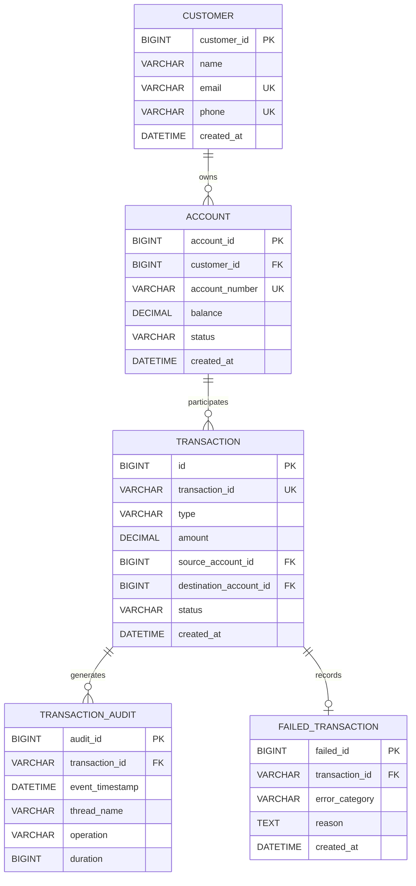

# Database Design

## 1. Introduction

MySQL will be used to store customer details, bank account information, transaction records, transaction audit logs and failed transaction details in the Banking Transaction System.

The database is designed to maintain data consistency, integrity and traceability while supporting concurrent transaction processing through multiple worker threads.

The database consists of five main tables. Each table has a specific responsibility so that data can be managed efficiently, duplication can be reduced and transaction activities can be tracked.

## 2. Tables and Their Responsibilities

### 2.1 customer

Stores basic customer information.

| Column | Type / Constraints | Description |
|---|---|---|
| customer_id | BIGINT PRIMARY KEY AUTO_INCREMENT | Unique customer ID |
| name | VARCHAR(100) NOT NULL | Customer's full name |
| email | VARCHAR(150) NOT NULL UNIQUE | Unique customer email |
| phone | VARCHAR(100) NOT NULL UNIQUE | Unique customer contact number |
| created_at | DATETIME NOT NULL DEFAULT CURRENT_TIMESTAMP | Record creation time |

### 2.2 account

Stores bank account information, account ownership, current balance and account status. Each account is associated with a customer through a foreign key.

| Column | Type / Constraints | Description |
|---|---|---|
| account_id | BIGINT PRIMARY KEY AUTO_INCREMENT | Primary key |
| customer_id | BIGINT NOT NULL (FK → customer.customer_id) | Account owner |
| account_number | VARCHAR(20) NOT NULL UNIQUE | Unique bank account number |
| balance | DECIMAL(19,2) NOT NULL DEFAULT 0.00 (CHECK balance >= 0) | Current account balance |
| status | VARCHAR(20) NOT NULL DEFAULT 'Active' (CHECK in 'Active', 'InActive', 'Frozen') | Account status |
| created_at | DATETIME NOT NULL DEFAULT CURRENT_TIMESTAMP | Account creation time |

Additional database constraints and indexes:

- `fk_account_customer`: Ensures the account belongs to an existing customer.
- `chk_account_balance`: Ensures that the account balance cannot be negative.
- `chk_account_status`: Restricts account status to the allowed values.
- `idx_account_customer`: Index on customer_id for faster customer-account lookups.

### 2.3 transaction

Stores deposit, withdrawal and transfer transaction records along with their transaction IDs, amounts, account references and processing outcomes.

The transaction table records transaction attempts and their outcomes so that successful and unsuccessful operations can be tracked.

| Column | Type / Constraints | Description |
|---|---|---|
| id | BIGINT PRIMARY KEY AUTO_INCREMENT | Internal primary key |
| transaction_id | VARCHAR(50) NOT NULL UNIQUE | Unique business transaction ID and idempotency identifier |
| type | VARCHAR(20) NOT NULL (CHECK in 'DEPOSIT', 'WITHDRAWAL', 'TRANSFER') | Transaction operation type |
| amount | DECIMAL(19,2) NOT NULL (CHECK amount > 0) | Transaction amount |
| source_account_id | BIGINT (FK → account.account_id) | Source account (NULL for deposit) |
| destination_account_id | BIGINT (FK → account.account_id) | Destination account (NULL for withdrawal) |
| status | VARCHAR(20) NOT NULL | Transaction outcome such as SUCCESS, FAILED or REJECTED |
| created_at | DATETIME NOT NULL DEFAULT CURRENT_TIMESTAMP | Transaction creation time |

Additional database constraints and indexes:

- `chk_transaction_amount`: Ensures transaction amounts are greater than zero.
- `chk_transaction_type`: Restricts transaction types to DEPOSIT, WITHDRAWAL and TRANSFER.
- Foreign keys on source_account_id and destination_account_id maintain account references.
- Indexes on source_account_id and destination_account_id improve transaction-related account lookups.
- Unique transaction_id helps prevent duplicate transaction processing.

### 2.4 transaction_audit

Stores audit information for transaction processing. It records the transaction identifier, operation result, executing thread, processing duration and related execution details to maintain traceability.

| Column | Type / Constraints | Description |
|---|---|---|
| audit_id | BIGINT PRIMARY KEY AUTO_INCREMENT | Unique audit record ID |
| transaction_id | VARCHAR(50) NOT NULL (FK → transaction.transaction_id) | Referenced transaction |
| event_timestamp | DATETIME NOT NULL DEFAULT CURRENT_TIMESTAMP | Audit event timestamp |
| thread_name | VARCHAR(100) | Name of the thread processing the transaction |
| operation | VARCHAR(100) NOT NULL | Operation or transaction event |
| duration | BIGINT (CHECK duration >= 0) | Processing duration in milliseconds |

Additional database constraints and indexes:

- `fk_audit_transaction`: Links the audit record to the corresponding transaction.
- `chk_audit_duration`: Ensures the recorded processing duration is not negative.
- `idx_audit_transaction`: Index on transaction_id for faster audit lookups.

The audit records help track transaction execution, worker-thread activity, operation results and processing performance.

### 2.5 failed_transaction

Stores failure and rejection details for transaction attempts that do not complete successfully. It helps identify the reason behind transaction failures and provides information for debugging, reporting and auditing.

| Column | Type / Constraints | Description |
|---|---|---|
| failed_id | BIGINT PRIMARY KEY AUTO_INCREMENT | Unique failure record ID |
| transaction_id | VARCHAR(100) NOT NULL (FK → transaction.transaction_id) | Referenced transaction |
| error_category | VARCHAR(200) NOT NULL | Categorized error or failure code |
| reason | TEXT NOT NULL | Detailed explanation of the failure |
| created_at | DATETIME NOT NULL DEFAULT CURRENT_TIMESTAMP | Failure record creation time |

Additional database constraints and indexes:

- `fk_failed_transaction`: Links the failure record to the corresponding transaction.
- `chk_error_category`: Restricts error categories to supported values, where enforced by the database schema.
- `idx_failed_category`: Index on error_category for faster failure reporting.

Failure categories may include:

- INSUFFICIENT_BALANCE
- INVALID_ACCOUNT
- ACCOUNT_FROZEN
- INVALID_AMOUNT
- TIMEOUT
- DUPLICATE_TRANSACTION

The exact error categories depend on the values implemented in the application and database schema.

## 3. Table Relationships

The database relationships are as follows:

- One customer can have multiple accounts.
- Each account belongs to one customer.
- One account can be involved in multiple transactions.
- A transaction can have a source account, a destination account or both depending on the operation.
- A transaction can have multiple audit records, depending on the audit implementation.
- A transaction can have one associated failed_transaction record when it fails or is rejected.

## 4. Data Integrity

The following database constraints are used to maintain data integrity:

- Primary keys uniquely identify records in each table.
- Foreign keys maintain relationships between customers, accounts and transaction records.
- Account numbers and transaction IDs must be unique.
- Transaction amounts must be greater than zero.
- Account balances must not become negative.
- Required fields must not accept NULL values.
- Account and transaction types must follow supported values.
- Account statuses must follow the allowed values.
- Transaction outcomes are recorded for tracking transaction processing.

## 5. Monetary Data

The DECIMAL(19,2) data type is used for account balances and transaction amounts to support accurate monetary storage.

Java BigDecimal is used for monetary calculations in the backend to avoid floating-point precision issues.

This helps maintain financial accuracy during deposits, withdrawals and transfers.

## 6. Indexing

Indexes are used on columns frequently involved in searches, joins and transaction lookups.

The database includes indexes on:

- account.customer_id
- transaction.source_account_id
- transaction.destination_account_id
- transaction_audit.transaction_id
- failed_transaction.error_category

Unique constraints also create indexes on important fields such as customer email, phone number, account number and transaction ID.

Indexes help improve the performance of queries used for transaction processing, account lookup, audit tracking and failure reporting.

## 7. Transaction Processing and Consistency

The Banking Transaction System uses transactional processing to maintain data consistency during deposits, withdrawals and transfers.

During transaction processing:

- Valid transaction requests are processed through the backend service layers.
- Account balance updates and transaction records are managed using database transactions.
- Account locking is used during transaction processing to prevent concurrent operations from incorrectly modifying the same account balance.
- Failed or rejected transaction attempts are recorded for traceability.
- Audit records are used to track transaction processing activities.

The system is designed to maintain accurate balances and prevent invalid financial operations during concurrent processing.

## 8. Audit Trail

The transaction_audit table maintains transaction execution details, including the transaction identifier, operation, executing thread and processing duration.

Audit information helps track transaction processing activities, investigate failures and monitor performance during sequential and parallel execution.

The audit trail supports the project's observability and traceability requirements.

## 9. ER Diagram

The following diagram represents the relationships between the five main database tables.

- customer → account
- account → transaction
- transaction → transaction_audit
- transaction → failed_transaction

## 9. ER Diagram

The following ER diagram represents the relationships between the five main tables in the Banking Transaction System.

